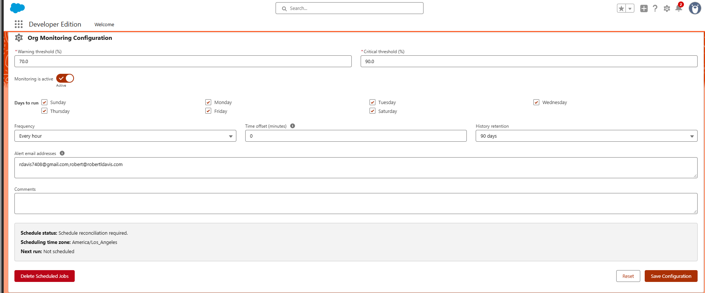
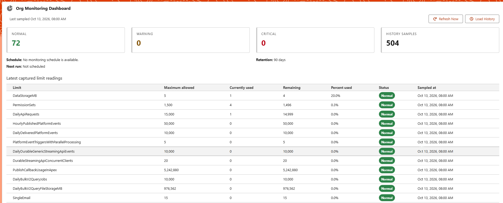
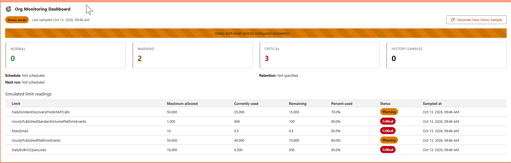
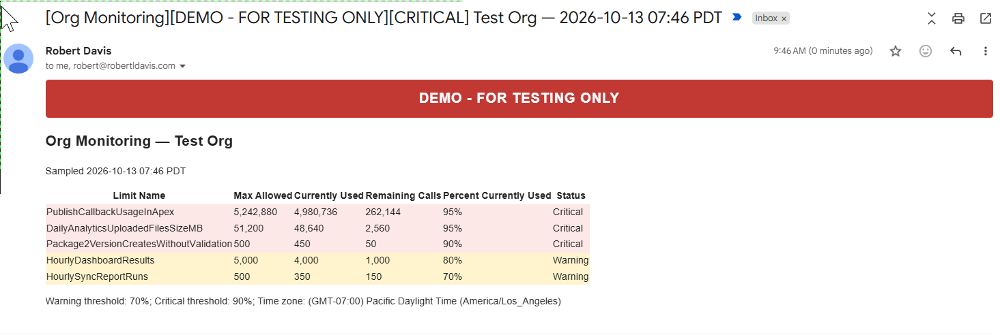

# Org Monitoring

A production-ready, automated Salesforce limit monitoring, alerting, and retention solution designed to provide continuous visibility into organization limits, protect org health, and deliver consolidated alerts before operational limits are reached.

---

## Table of Contents

- [Features](#features)
- [Architecture](#architecture)
- [Security](#security)
- [Setup & Configuration](#setup--configuration)
  - [Org Monitoring Configuration](#org-monitoring-configuration)
  - [Production Dashboard](#production-dashboard)
  - [Demo Mode Dashboard](#demo-mode-dashboard)
  - [Alert Email Notifications](#alert-email-notifications)
- [Known Limitations](#known-limitations)
- [License](#license)
- [Unlocked Package Installation](#unlocked-package-installation)

---

## Features

- **Comprehensive Limit Coverage:** Dynamically reads and tracks all positive-maximum organization limits returned by `System.OrgLimits.getMap()` (e.g., API requests, custom metadata, data storage, async Apex executions, single email invocations).
- **Automated Scheduling:** Configurable scheduling engine running on 1, 2, 4, 6, 8, 12, or 24-hour cycles with minute offsets from midnight on designated days of the week.
- **Consolidated Alerting:** Sends a single, consolidated HTML and plain-text email only when one or more monitored limits breach defined Warning or Critical thresholds.
- **Configurable History Retention:** Automatically purges historical limit readings on an actual-time cutoff policy (30, 60, 90, 120 days, or **Keep Forever**).
- **Interactive UI (LWC):**
  - **Configuration Component:** Centralized admin UI to configure thresholds, schedules, weekdays, time offsets, retention, alert recipients, and manage scheduled jobs.
  - **Dashboard Component:** Real-time visibility into current limit consumption, status classifications (Normal, Warning, Critical), next scheduled run, and searchable/filterable historical records.
- **Interactive Demo Mode:** Lightning App Builder property allowing administrators and evaluators to preview simulated Warning and Critical states with demo email alerts without polluting production data or interfering with scheduled jobs.

---

## Architecture

Org Monitoring is engineered following enterprise Salesforce layered architectural patterns:

```
┌─────────────────────────────────────────────────────────────┐
│                 Lightning App Page (UI)                     │
│   orgMonitoringConfiguration   │   orgMonitoringDashboard   │
└──────────────────────────────┬──────────────────────────────┘
                               │
                               ▼
┌─────────────────────────────────────────────────────────────┐
│                 Controller & Service Layer                  │
│  OrgMonitoringController  │  OrgMonitoringService           │
│  OrgMonitoringConfigService│  OrgMonitoringScheduleService   │
│  OrgMonitoringEmailService│  OrgLimitsProvider (Virtual)    │
└──────────────────────────────┬──────────────────────────────┘
                               │
                               ▼
┌─────────────────────────────────────────────────────────────┐
│                   Selector & Repository                     │
│  OrgLimitSelector         │  OrgLimitRepository             │
│  OrgMonitoringRunSelector │  OrgMonitoringConfigRepository  │
│  OrgMonitoringScheduleSelector                              │
└──────────────────────────────┬──────────────────────────────┘
                               │
                               ▼
┌─────────────────────────────────────────────────────────────┐
│                 Asynchronous Execution                      │
│  OrgMonitoringScheduler   │  OrgMonitoringPurgeJob (Batch)  │
│  OrgMonitoringRunPurgeBatch (Batch)                         │
└──────────────────────────────┬──────────────────────────────┘
                               │
                               ▼
┌─────────────────────────────────────────────────────────────┐
│                     Custom Data Model                       │
│  Org_Monitoring_Configuration__c (Singleton settings)       │
│  Org_Limit__c (Historical limit snapshots)                  │
│  Org_Monitoring_Run__c (Audit logs of monitor & purge runs) │
└─────────────────────────────────────────────────────────────┘
```

- **Controller Layer (`OrgMonitoringController`):** Thin `@AuraEnabled` entry points enforcing user authentication, custom permissions, object-level security (CRUD), and field-level security (FLS).
- **Service Layer (`OrgMonitoringService`, `OrgMonitoringConfigService`, etc.):** Orchestrates business logic, validates inputs, manages schedule cron reconciliation, classifies limits, and constructs alert emails.
- **Data Access Layer (`OrgLimitSelector`, `OrgLimitRepository`, etc.):** Separates SOQL queries (utilizing `WITH USER_MODE` and parameterized binds) from DML operations with partial success handling (`Database.insert(records, false)`).
- **Asynchronous & Jobs Engine:** Independent Apex Scheduler (`OrgMonitoringScheduler`) for limit evaluations and Batch Apex (`OrgMonitoringPurgeJob`, `OrgMonitoringRunPurgeBatch`) for retention cleanup.

---

## Security

- **Permission Set:** The application includes the **`Org_Monitoring_Administrator`** permission set.
  - Grants the custom permission **`Manage_Org_Monitoring`**.
  - Grants full CRUD permissions and Field-Level Security (FLS) to `Org_Monitoring_Configuration__c`, `Org_Limit__c`, and `Org_Monitoring_Run__c`.
  - Grants Apex execution access to all Org Monitoring controller, service, selector, repository, and job classes.
- **Access Control:** Only users assigned the **`Org_Monitoring_Administrator`** permission set can access the configuration panel, modify schedules, view configured recipient emails, and abort scheduled jobs.
- **Data Protection:** All custom objects are set to `Private` sharing model. Queries enforce user mode and describes validate object/field accessibility.

---

## Setup & Configuration

Follow these steps to configure Org Monitoring in your org:

1. **Assign Permission Set:** Assign the **Org Monitoring Administrator** permission set to the designated administrator/scheduler user:
   - Navigate to **Setup > Permission Sets > Org Monitoring Administrator > Manage Assignments**.
2. **Add to Lightning App:** Open the Lightning App Builder and activate the **Org Monitoring** App Page, or add the `orgMonitoringConfiguration` and `orgMonitoringDashboard` LWCs to your chosen page.
3. **Initialize Configuration:** Open the Org Monitoring page. If prompted, click **Initialize Configuration** to create the canonical `Default` configuration record.

### Org Monitoring Configuration

The configuration component allows administrators to customize monitoring parameters, threshold boundaries, schedules, and recipients.



| Configuration Field        | Description                                                                                                                                                                                         |
| -------------------------- | --------------------------------------------------------------------------------------------------------------------------------------------------------------------------------------------------- |
| **Warning threshold (%)**  | The percentage threshold (0–100) at which a limit transitions to **Warning** status (default: 70.00%).                                                                                              |
| **Critical threshold (%)** | The percentage threshold (> Warning and ≤ 100) at which a limit transitions to **Critical** status (default: 90.00%).                                                                               |
| **Monitoring is active**   | Master switch to pause or resume automated limit monitoring. Pausing cancels the scheduled monitor job while preserving configuration and purge schedules.                                          |
| **Days to run**            | Select the days of the week (Sunday through Saturday) on which monitoring should execute.                                                                                                           |
| **Frequency**              | How often monitoring runs on selected days (`1`, `2`, `4`, `6`, `8`, `12`, or `24` hours; `24` represents once daily).                                                                              |
| **Time offset (minutes)**  | Number of minutes after local midnight for job runs (must be less than `Frequency × 60`). Guarantees predictable run times (e.g., 12-hour frequency with 90-minute offset runs at 01:30 and 13:30). |
| **History retention**      | Number of days to retain historical readings before automated purging (`30`, `60`, `90`, `120` days, or `Keep Forever`).                                                                            |
| **Alert email addresses**  | Comma- or semicolon-separated list of recipient email addresses that receive alert notifications when Warning or Critical conditions exist.                                                         |
| **Comments**               | Optional operational notes describing the monitoring policy or changes.                                                                                                                             |
| **Schedule summary**       | Real-time display showing current schedule status, designated scheduling time zone, and the calculated next run time.                                                                               |
| **Delete Scheduled Jobs**  | A dedicated administrative action to immediately abort all active Org Monitoring scheduled jobs (monitoring and purge) directly from the UI.                                                        |

---

### Production Dashboard

The production dashboard displays the current operational health of your organization limits under normal operating conditions.



| Dashboard Element                              | Description                                                                                                                         |
| ---------------------------------------------- | ----------------------------------------------------------------------------------------------------------------------------------- |
| **Status Cards (Normal / Warning / Critical)** | Quick-glance counters displaying the distribution of limits currently in Normal, Warning, or Critical state.                        |
| **History Samples Counter**                    | Total count of persisted historical limit readings stored in the organization.                                                      |
| **Schedule & Next Run**                        | Displays current scheduler operational status, the next scheduled run timestamp, and the active retention policy.                   |
| **Latest Org Limit Readings Table**            | Real-time list of monitored limits showing: Limit Name, Maximum Allowed, Currently Used, Remaining, Percent Used, and Status badge. |
| **Load History**                               | Allows searching, sorting, and date-filtering historical snapshots of individual limits across prior runs.                          |

---

### Demo Mode Dashboard

When testing or demonstrating the package, administrators can enable **Demo Mode** in the Lightning App Builder page configuration. Demo Mode simulates limit consumption using actual limit names without touching production data, altering schedules, or running batch jobs.



| Demo Element                            | Description                                                                                                              |
| --------------------------------------- | ------------------------------------------------------------------------------------------------------------------------ |
| **Demo Mode Badge & Banner**            | A clear warning banner indicating that simulated data is active and production limits are untouched.                     |
| **Simulated Critical & Warning States** | Synthesizes a sample of org limits with guaranteed Warning and Critical statuses to test UI responsiveness and alerting. |
| **Generate New Demo Sample**            | Generates a fresh random sample of limits and simulated consumption values on demand.                                    |

---

### Alert Email Notifications

When automated monitoring executes (or when in Demo Mode with configured recipients), the service generates a consolidated alert notification if any limit meets or exceeds the Warning or Critical thresholds.



- **Single Consolidated Email:** Summarizes all breached limits into one clean notification rather than flooding inboxes with individual alerts.
- **Clear Severity Indicators:** Breaks down Critical and Warning items with clear metrics (Current, Maximum, Remaining, and Percent Used).
- **Demo Mode Notice:** In Demo Mode, alert emails prominently include a **`DEMO - FOR TESTING ONLY`** header to ensure testing messages are never confused with production issues.

---

## Known Limitations

- **System.OrgLimits Scope:** Org Monitoring evaluates limits provided by the native `System.OrgLimits.getMap()` method. Any Salesforce limits not surfaced by this API (or limits without positive maximum values) cannot be evaluated.
- **Scheduler Time Zone:** Scheduled Apex jobs execute according to the time zone of the user who scheduled the job. To ensure schedules align with business expectations, configuration saves must be submitted by an administrator in the desired scheduling time zone.
- **Salesforce Email Limits:** Consolidated email notifications are subject to standard Salesforce single-email daily limits and governor limits (a maximum of 150 recipient addresses is supported per alert).

---

## License

This project is licensed under the **MIT License**.

```
MIT License
Copyright (c) 2026 Robert Davis

Permission is hereby granted, free of charge, to any person obtaining a copy
of this software and associated documentation files (the "Software"), to deal
in the Software without restriction, including without limitation the rights
to use, copy, modify, merge, publish, distribute, sublicense, and/or sell
copies of the Software, and to permit persons to whom the Software is
furnished to do so, subject to the following conditions:

The above copyright notice and this permission notice shall be included in all
copies or substantial portions of the Software.

THE SOFTWARE IS PROVIDED "AS IS", WITHOUT WARRANTY OF ANY KIND, EXPRESS OR
IMPLIED, INCLUDING BUT NOT LIMITED TO THE WARRANTIES OF MERCHANTABILITY,
FITNESS FOR A PARTICULAR PURPOSE AND NONINFRINGEMENT. IN NO EVENT SHALL THE
AUTHORS OR COPYRIGHT HOLDERS BE LIABLE FOR ANY CLAIM, DAMAGES OR OTHER
LIABILITY, WHETHER IN AN ACTION OF CONTRACT, TORT OR OTHERWISE, ARISING FROM,
OUT OF OR IN CONNECTION WITH THE SOFTWARE OR THE USE OR OTHER DEALINGS IN THE
SOFTWARE.
```

The full license text can also be viewed in [mit-license.md](mit-license/mit-license.md).

---

## Unlocked Package Installation

> **Important:** Always test in a Sandbox prior to installation in Production.

### Installation URLs

- **Production / Developer Edition Orgs:**  
  [https://login.salesforce.com/packaging/installPackage.apexp?p0=04tg8000000TPELAA4](https://login.salesforce.com/packaging/installPackage.apexp?p0=04tg8000000TPELAA4)

- **Sandbox Orgs:**  
  [https://test.salesforce.com/packaging/installPackage.apexp?p0=04tg8000000TPELAA4](https://test.salesforce.com/packaging/installPackage.apexp?p0=04tg8000000TPELAA4)

### Salesforce CLI Installation

Install directly to an authorized org using the Salesforce CLI:

```powershell
sf package install --package "04tg8000000TPELAA4" --target-org <target-org-alias> --wait 30
```
